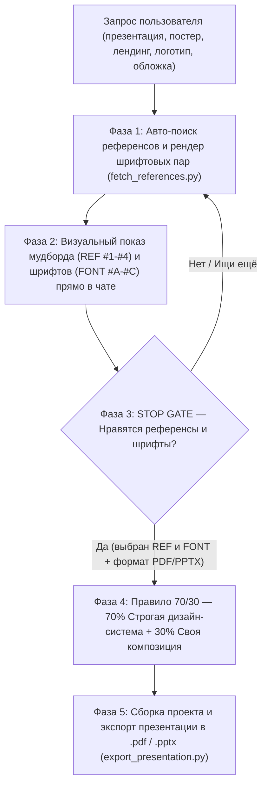
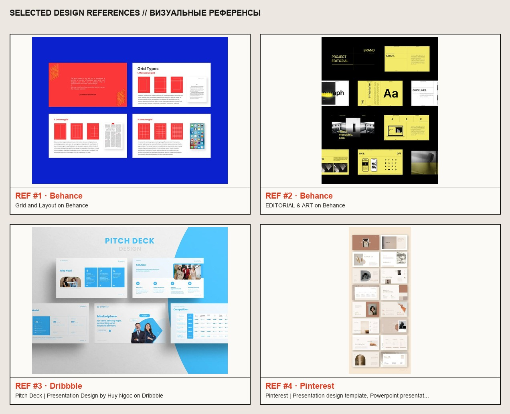
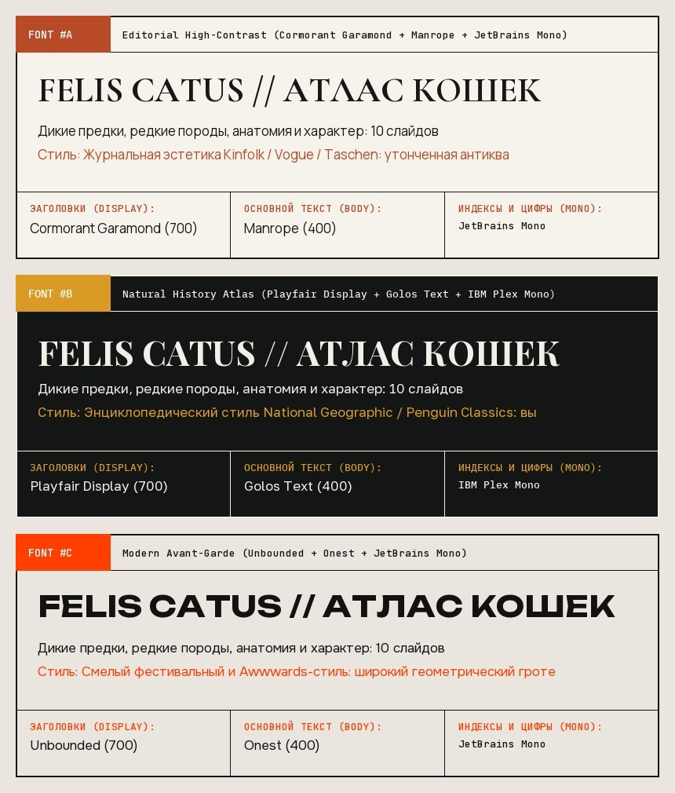
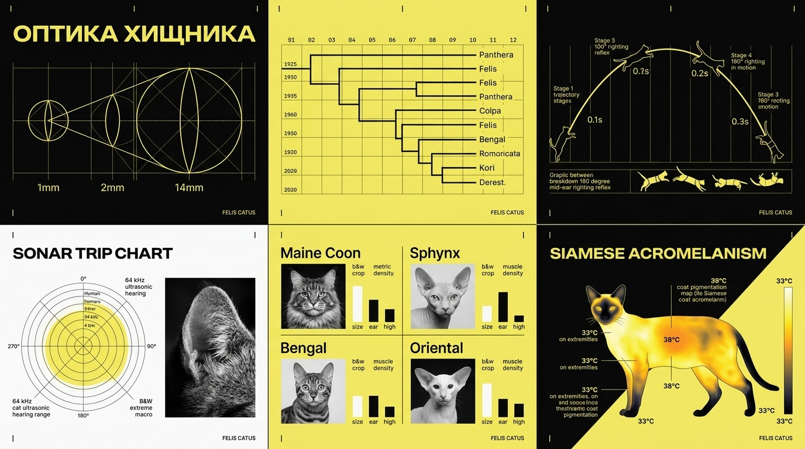
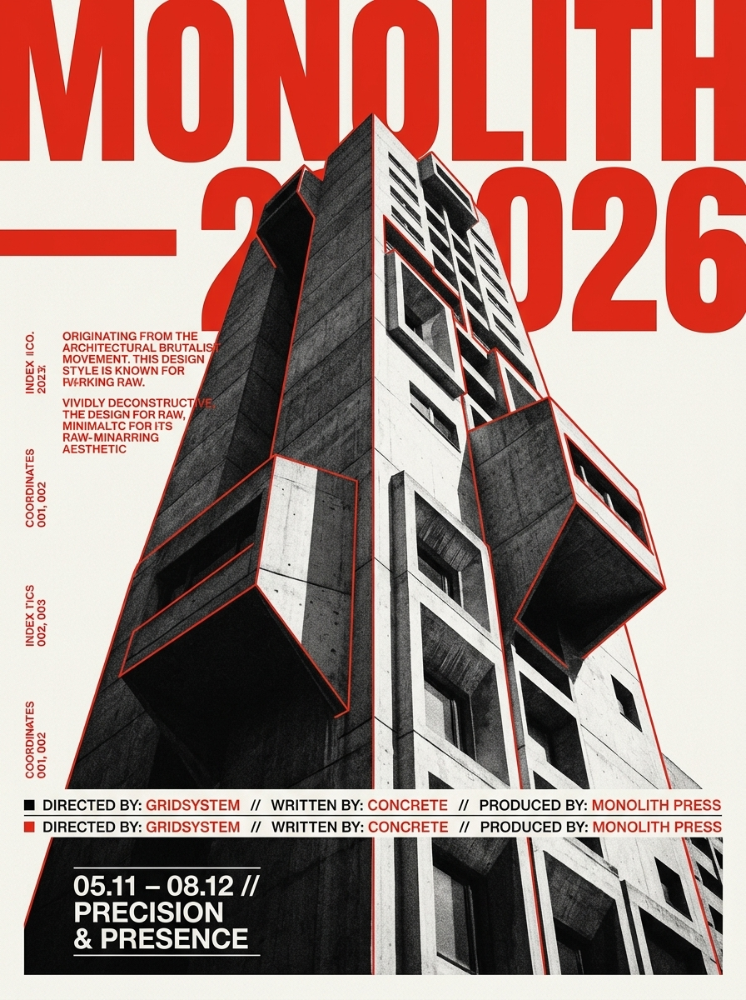
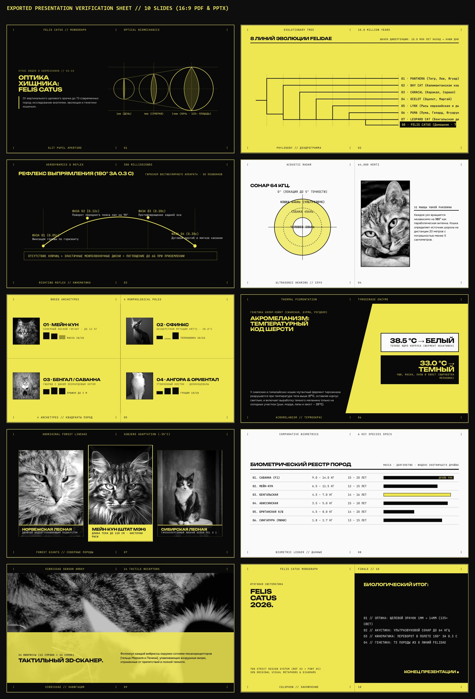

# 🎨 Reference-Driven Design Skill (`reference-driven-design`)

**Референс-ориентированный дизайн-пайплайн для AI-агентов (Antigravity / Claude Code / Cursor / Gemini)** — глобальный скилл, который запрещает нейросети придумывать «пластиковый ИИ-дизайн из головы» и переводит её на профессиональный процесс реальной арт-дирекшн студии: **Поиск живых референсов и шрифтов → Визуальный показ пользователю → Обязательное согласование → Синтез 70/30 (Строгая дизайн-система + Авторская фантазия) → Экспорт презентаций в `.pdf` / `.pptx`**.

---

## 🚀 Зачем нужен этот скилл и какую проблему он решает?

По умолчанию, когда вы просите нейросеть сделать презентацию, лендинг, постер, логотип или обложку книги, она генерирует шаблонные решения из абстрактного вакуума:
- клишированные фиолетово-синие градиенты и одинаковые карточки;
- дефолтные системные шрифты без характера (`Arial`, `Inter`, `Roboto`);
- при просьбе «сделать по референсу» — либо игнорирует референс, либо бездумно копирует чужие блоки и мокапы 1-в-1;
- при просьбе сделать презентацию — отдаёт сырой HTML-сайт вместо нормального **`.pdf`** или **`.pptx`** файла.

**`reference-driven-design`** полностью меняет поведение агента на каждом этапе работы с визуалом.

---

## ⚙️ Как работает скилл (5 обязательных фаз)



### Фаза 1. Автоматический поиск реальных референсов и шрифтовых пар (`scripts/fetch_references.py`)
Перед тем как написать хоть строчку кода или сгенерировать картинку, агент запускает скрипт `fetch_references.py`, который:
1. Находит и скачивает **4 реальных дизайн-проекта** с **Behance**, **Pinterest**, **BP&O (Brand New / Branding, Packaging and Opinion)**, **Fonts In Use**, **Dribbble** и **Awwwards**.
2. Склеивает их в наглядный визуальный мудборд `2×2` (`ref_moodboard.jpg`) с подписями `REF #1 .. REF #4` и источниками.
3. На лету скачивает оригинальные `.ttf` файлы шрифтов из **Google Fonts** (с полной поддержкой **кириллицы и латиницы**) и рендерит **3 карточки шрифтовых пар (`FONT #A`, `FONT #B`, `FONT #C`)** прямо с заголовком вашей задачи:
   - `editorial`: **Cormorant Garamond** + **Manrope** + **JetBrains Mono** *(высокая редакционная классика, антиква + гротеск)*
   - `literary`: **Playfair Display** + **Golos Text** + **JetBrains Mono** *(контрастная журнальная и книжная типографика)*
   - `avantgarde`: **Unbounded** + **Onest** + **JetBrains Mono** *(широкий брутализм, выставки и современные презентации)*
   - `sculptural`: **Forum** + **Manrope** + **IBM Plex Mono** *(монументальная классика и архитектура)*
   - `swiss`: **Oswald** + **Inter** + **JetBrains Mono** *(швейцарский интернациональный плакатный стиль)*

#### Пример автоматически собранного мудборда референсов (`ref_moodboard.jpg`):


#### Пример автоматически сгенерированной витрины шрифтовых пар (`ref_fonts_sheet.jpg`):


---

### Фаза 2 и 3. Визуальный показ пользователю и жёсткий стоп-гейт согласования (`Approval Gate`)
Агент **обязан** вывести скачанные изображения референсов и шрифтовых пар прямо в чат (через интерактивный таб-виджет `<agent-embed>` и превью-артефакт) и **остановиться**, спросив вас:
> *«Вот реальные визуальные референсы (`REF #1 – #4`) и шрифтовые пары (`FONT #A – #C`). Какие из них тебе нравятся по стилю и композиции? Берём их в работу или поищем другие? В каком формате собрать итоговую презентацию — **PDF (`.pdf`)** или **PowerPoint (`.pptx`)**?»*

- Если вам **не нравятся** предложенные варианты — агент запускает поиск заново с другими запросами и стилями.
- Только после вашего **явного одобрения** агент переходит к созданию дизайна.

---

### Фаза 4. Правило «70% Строгая Дизайн-Система / 30% Авторская Фантазия» (`Same Studio, New Project`)
Агент работает как арт-директор той же студии, которая сделала выбранный референс, но создающий **новый оригинальный проект**:
- **70% — Строгая Дизайн-Система (берётся 1-в-1 из референса)**:
  - точная цветовая палитра и пропорции фонов/акцентов (например, `#0A0A0A` оникс + `#EFE852` кислотно-жёлтый + `#FAFAFA` бумага + Ч/Б фото);
  - модульная сетка, отступы, количество «воздуха» (`negative space`), толщина разделительных линий (`1px` табличные линии, угловые засечки `|` / `+`), колонтитулы и система нумерации;
  - утверждённая шрифтовая пара (`Display` + `Body` + `Mono`).
- **30% — Авторская фантазия и свои композиции (без слепого копирования блоков)**:
  - нейросеть **не копирует** чужие мокапы телефонов, кружочки Pantone или бессмысленные плашки из референса;
  - вместо этого внутри дизайн-системы она придумывает **собственные визуальные метафоры, кастомные SVG-чертежи, схемы, графики и уникальные раскладки** под тему вашего проекта.

#### Пример работы правила 70/30 (концепт-борд презентации и выставочный постер):
| Авторские слайды в дизайн-системе `REF #2` + `FONT #C` | Выставочный постер по дизайн-системе референса |
| :---: | :---: |
|  |  |

---

### Фаза 5. Экспорт презентаций в `.pdf` и `.pptx` (`scripts/export_presentation.py`)
Когда вы заказываете презентацию или питч-дек, агент **не оставляет её просто HTML-страницей**, а компилирует через `scripts/export_presentation.py` в готовые файлы:
1. **Векторный `16:9` PDF (`.pdf`)** — со всеми вшитыми шрифтами Google Fonts, идеальной векторной графикой и нулевыми полями печати (`@page`).
2. **Широкоэкранный `16:9` PowerPoint (`.pptx`)** — слайды в разрешении Retina `2560×1440` (благодаря чему нестандартные шрифты вроде `Unbounded` и сложная модульная сетка открываются без единого сдвига на любом ПК или Mac) + заголовки слайдов автоматически добавляются в заметки докладчика (`Speaker Notes`).
3. **Контрольный превью-лист (`_preview.jpg`)** — склейка всех экспортированных слайдов, которую агент проверяет глазами перед тем, как отдать файл.

#### Пример экспортированных 10 слайдов в `.pdf` и `.pptx`:


*(Примеры готовых файлов лежат прямо в папке [`assets/`](assets/): [`demo_felis_catus_presentation.pdf`](assets/demo_felis_catus_presentation.pdf) и [`demo_felis_catus_presentation.pptx`](assets/demo_felis_catus_presentation.pptx)).*

---

## 📦 Структура репозитория

```text
reference-driven-design-skill/
├── README.md                          # Документация и руководство по установке
├── requirements.txt                   # Python-зависимости (Pillow, PyMuPDF, python-pptx)
├── install.ps1                        # Автоматический установщик для Windows (PowerShell)
├── install.sh                         # Автоматический установщик для macOS / Linux (Bash)
├── skills/
│   └── reference-driven-design/       # Папка скилла (копируется в ~/.gemini/config/skills/)
│       ├── SKILL.md                   # Главная инструкция и правила для нейросети
│       ├── references/
│       │   └── platform-queries-and-dna.md  # База поисковых дорков (Behance/Pinterest/BP&O) и разбора ДНК
│       └── scripts/
│           ├── fetch_references.py    # Парсер референсов + генератор мудборда и карточек шрифтов (.ttf)
│           └── export_presentation.py # Конвертер презентаций в векторный 16:9 .pdf и Retina .pptx
└── assets/                            # Примеры работы скилла (мудборды, шрифты, PDF, PPTX)
```

---

## 🛠️ Подробная инструкция по установке

### Требования
- **Python 3.10+**
- **Google Chrome** или **Microsoft Edge** (используется в headless-режиме для пиксель-перфект рендера Google Fonts и SVG при экспорте в `.pdf` и `.pptx`)

---

### Вариант 1: Быстрая установка в 1 команду (Рекомендуется)

#### На Windows (PowerShell):
```powershell
git clone https://github.com/kitykat8/reference-driven-design-skill.git
cd reference-driven-design-skill
powershell -ExecutionPolicy Bypass -File .\install.ps1
```

#### На macOS / Linux (Terminal):
```bash
git clone https://github.com/kitykat8/reference-driven-design-skill.git
cd reference-driven-design-skill
chmod +x install.sh
./install.sh
```

Скрипт автоматически:
1. Установит библиотеки `Pillow`, `pymupdf` и `python-pptx`.
2. Скопирует скилл в глобальную директорию `~/.gemini/config/skills/reference-driven-design`.
3. Пропишет корректные пути под вашу учётную запись и проверит работоспособность скриптов.

---

### Вариант 2: Ручная установка (по шагам)

1. **Установите зависимости Python**:
   ```bash
   pip install Pillow pymupdf python-pptx reportlab
   ```
2. **Скопируйте папку скилла** `skills/reference-driven-design` в вашу глобальную папку скиллов:
   - **Windows**: `C:\Users\<ИМЯ_ПОЛЬЗОВАТЕЛЯ>\.gemini\config\skills\reference-driven-design`
   - **macOS / Linux**: `~/.gemini/config/skills/reference-driven-design`
3. **(Опционально, но рекомендуется) Добавьте правило обязательного автозапуска в `AGENTS.md`**:
   Чтобы нейросеть **всегда** включала этот скилл без напоминаний при любой визуальной задаче, добавьте в ваш глобальный файл правил (`~/.gemini/config/plugins/elite-engineering-suite/rules/AGENTS.md` или `~/.gemini/GEMINI.md`) следующий блок:
   ```markdown
   - **Mandatory Reference-Driven Design & Approval Gate**: Whenever creating anything visual or design-related (logos, presentations, book covers, posters, editorial layouts in InDesign/Illustrator, brand identity, banners, or UI), NEVER invent designs from an abstract vacuum. Always activate the `reference-driven-design` skill first:
     1. Actively search and visually display 2–4 real references (Pinterest, Behance, Fonts In Use, BP&O, Dribbble, Awwwards) plus curated font pairings.
     2. **STOP and ask the user whether they like the selected references** (and for presentations, whether they want `.pdf` or `.pptx`) before generating or coding the design.
     3. **Strict Design System + Creative Imagination**: Once approved, strictly lock in the reference's **design system** (grid, margins, spacing rhythm, color palette, typography hierarchy, line/border rules), but **do NOT copy the reference's blocks 1:1** — use creative imagination to invent original compositions, visual metaphors, and custom layouts within that design system.
     4. **Presentations as `.pdf` or `.pptx` (Never Just a Website)**: Whenever creating a presentation or slide deck, deliver the final result as a **PDF (`.pdf`)** or **PowerPoint (`.pptx`)** file (as requested by the user, or both) via `export_presentation.py`, never merely as an HTML webpage.
   ```

---

## 💻 Примеры использования скриптов вручную (CLI)

### 1. Скачать референсы + сгенерировать витрину шрифтовых пар (`fetch_references.py`)
```powershell
python ~/.gemini/config/skills/reference-driven-design/scripts/fetch_references.py `
  -q "behance.net presentation design editorial grid typography" `
  -q "pinterest.com swiss brutalist slide deck layout" `
  --sample-title "АРХИТЕКТУРА БУДУЩЕГО" `
  --sample-sub "Модульные пространства, свет и бетон: исследование современной урбанистики." `
  --font-presets "editorial,literary,avantgarde" `
  -o "./output_refs" `
  -c 4 `
  -p "deck"
```

### 2. Экспортировать презентацию в векторный `.pdf` и широкоэкранный `.pptx` (`export_presentation.py`)
```powershell
python ~/.gemini/config/skills/reference-driven-design/scripts/export_presentation.py `
  --input "./slides_source.html" `
  --pdf "./presentation.pdf" `
  --pptx "./presentation.pptx" `
  --preview "./slides_preview.jpg" `
  --slides 10 `
  --base-width 800
```

---

## 📄 Лицензия
MIT License — свободно используйте, модифицируйте и делитесь!
